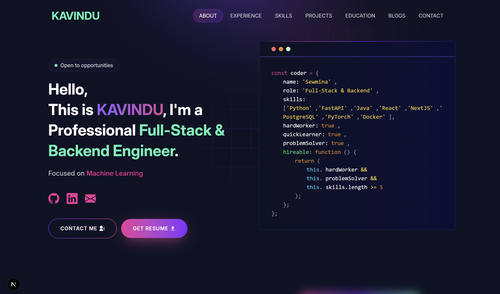

<p align="center">
  
</p>
<div align="center">

# 🚀 Next.js Developer Portfolio Template

**A clean, high-performance, and animated developer portfolio built with Next.js, React, Tailwind CSS, Sass, and Framer Motion.**

[](https://opensource.org/licenses/MIT)
[](https://nextjs.org/)
[](https://react.dev/)
[](https://tailwindcss.com/)
[](https://www.framer.com/motion/)

[Live Preview](http://localhost:3000) • [Getting Started](#-getting-started) • [Customization](#-customization-guide) • [License](#-license)

</div>

---

## 🌟 Overview

This open-source (FOSS) developer portfolio template is designed for software engineers, full-stack developers, backend architects, and data scientists looking to showcase their work with elegance and speed. 

It features an iconic code-window interface, interactive glow cards, smooth entrance animations, continuous skill marquees, and a zero-runtime-dependency setup.

Included by default is a realistic, fictional Sri Lankan developer persona (**Kavindu Jayasundara**) with sample projects and experience, ready to be replaced with your own credentials.

---

## ✨ Features

- ⚡ **Next.js & React App Router**: Modern SSR & static optimization for blazing fast load times.
- 🎨 **Dark Navy & Neon Accent Aesthetics**: Tailored color palette with deep background tones, vibrant violet, pink gradients, and emerald highlights (`#16f2b3`).
- 💻 **Interactive Hero Terminal**: Animated code card with syntax-highlighted coder profile and dynamic typewriter for technical roles.
- 🧲 **Magnetic Buttons & Navigation Pill**: Fluid pointer attraction physics and scroll-spied navigation indicator.
- ✨ **Interactive Mouse Glow Cards**: Dynamic radial lighting effects following cursor proximity.
- 📜 **Sticky Stackable Projects**: Smooth vertical stacking effect for featured engineering case studies.
- ♾️ **Dual Continuous Skills Marquee**: Infinite marquee powered by `react-fast-marquee`.
- 🔒 **100% Fully Local & Privacy-Friendly**: All fonts (`Inter`), SVG icons, and Lottie JSON animations are bundled locally. No tracking scripts, Google CDNs, or external runtime API dependencies.
- 📧 **Serverless Contact Flow**: Native `mailto:` integration that directly opens the visitor's mail client with pre-filled inquiries.
- 📱 **Fully Responsive**: Mobile-first layout optimized across all screen sizes and orientations.

---

## 🛠️ Tech Stack

| Technology | Purpose |
| :--- | :--- |
| **Next.js 16** | Full-stack React framework (Turbopack) |
| **React 19** | Component architecture & client-side state |
| **Framer Motion** | Physics-based animations, layout transitions & scroll reveals |
| **Tailwind CSS & Sass** | Responsive utility classes & custom SCSS styles |
| **Lottie React** | Lightweight vector animations |
| **React Icons** | Curated SVG icons |
| **React Fast Marquee** | High-performance marquee ticker |

---

## 🚀 Getting Started

### Prerequisites

- [Node.js](https://nodejs.org/) (version 18.17 or higher recommended)
- `npm` or `yarn` or `pnpm`

### Installation

1. **Clone the repository:**
   ```bash
   git clone https://github.com/Sewmina-as/sewmina-portfolio.git
   cd sewmina-portfolio
   ```

2. **Install dependencies:**
   ```bash
   npm install
   ```

3. **Start the development server:**
   ```bash
   npm run dev
   ```

4. **Open your browser:**
   Navigate to [http://localhost:3000](http://localhost:3000) to see the portfolio live.

5. **Build for production:**
   ```bash
   npm run build
   npm run start
   ```

---

## 🎨 Customization Guide

Personalizing the portfolio takes just a few minutes. All personal data, projects, and content are centralized in `utils/data/`:

| File | What to Customize |
| :--- | :--- |
| [`utils/data/personal-data.js`](./utils/data/personal-data.js) | Your name, title, roles, bio, social links (GitHub, LinkedIn), email, phone, location |
| [`utils/data/educations.js`](./utils/data/educations.js) | Degrees, institutions, and dates |
| [`utils/data/experience.js`](./utils/data/experience.js) | Work experience, internships, and research roles |
| [`utils/data/projects-data.js`](./utils/data/projects-data.js) | Featured project names, descriptions, tools, code repo URLs, and demo links |
| [`utils/data/skills.js`](./utils/data/skills.js) | List of skills displayed in the animated marquee |
| [`utils/data/posts.js`](./utils/data/posts.js) | Engineering articles, blog summaries, and links |
| [`public/profile.png`](./public/profile.png) | Replace with your profile portrait |
| [`public/resume.pdf`](./public/resume.pdf) | Replace with your downloadable resume |

---

## 📁 Project Structure

```text
sewmina-portfolio/
├── app/
│   ├── blog/              # Blog listing page route
│   ├── components/
│   │   ├── helper/        # Animation primitives, GlowCard, Magnetic, CodeWindow
│   │   ├── homepage/      # Hero, About, Experience, Skills, Projects, Education, Contact
│   │   ├── footer.jsx     # Global footer with copyright and author credits
│   │   └── navbar.jsx     # Animated sticky header navigation
│   ├── css/               # SCSS stylesheets and global styles
│   ├── layout.js          # Root layout and dynamic metadata
│   └── page.js            # Single-page home entry point
├── public/                # Static assets, fonts, SVGs, and placeholder images
├── utils/
│   ├── check-email.js     # Form email validation utility
│   ├── skill-image.js     # Skill logo mapping utility
│   └── data/              # Centralized data files for personal details & projects
├── LICENSE                # MIT License
├── next.config.js         # Next.js configuration
├── package.json           # Project manifest
└── README.md              # Project documentation
```

---

## 🚢 Deployment

### Deploy with Vercel (Recommended)

1. Push your code to GitHub.
2. Go to [Vercel](https://vercel.com/) and click **"New Project"**.
3. Import your GitHub repository.
4. Deploy! Next.js will automatically build and publish your portfolio with edge performance.

---

## 🤝 Contributing

Contributions, issues, and feature requests are welcome!

1. Fork the Project
2. Create your Feature Branch (`git checkout -b feature/AmazingFeature`)
3. Commit your Changes (`git commit -m 'Add some AmazingFeature'`)
4. Push to the Branch (`git push origin feature/AmazingFeature`)
5. Open a Pull Request

---

## 📄 License

This project is licensed under the **MIT License** — see the [LICENSE](./LICENSE) file for details.

```text
Copyright (c) 2026 Achintha Sewmina Gamage (https://github.com/Sewmina-as)
```

---

## 👤 Author & Credits

- **Author & Copyright Holder**: [Achintha Sewmina Gamage](https://github.com/Sewmina-as)
  - GitHub: [@Sewmina-as](https://github.com/Sewmina-as)
  - LinkedIn: [Achintha Sewmina Gamage](https://www.linkedin.com/in/sewminagamage)

*Give a ⭐️ if this project helped you build your portfolio!*
